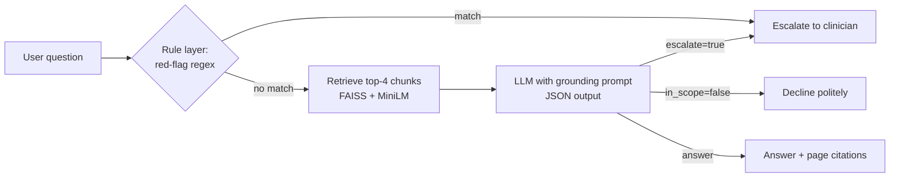

# Mamasguide
# MamaGuide: Guideline-Grounded Maternal Health Assistant with Safety Evals

A retrieval-augmented generation (RAG) assistant that answers pregnancy questions **only** from the WHO antenatal care guideline, cites the pages it used, and **escalates red-flag symptoms to a clinician** instead of answering. It ships with an evaluation harness that measures grounding, citation rate, escalation behavior, and out-of-scope refusals.

> Educational prototype. Not medical advice.

**Notebook:** [`MamaGuide_RAG_Safety_Evals.ipynb`](MamaGuide_RAG_Safety_Evals.ipynb) · **Live demo:** _[Hugging Face Space link]_

## Why this project

In clinical AI, a fluent answer is not enough. The system has to be **correct, grounded in vetted guidance, and know when not to answer**. MamaGuide is built evaluation-first: every safety claim is backed by a test.

## Architecture

**Defense in depth**
1. **Rule layer:** deterministic red-flag detection (heavy bleeding, severe headache with vision changes, reduced fetal movement, self-harm thoughts, and more) runs *before* the LLM, so emergencies never depend on model behavior.
2. **LLM layer:** the model answers only from retrieved excerpts, returns structured JSON (`answer`, `pages`, `escalate`, `in_scope`), escalates urgent symptoms, and declines questions the guideline does not cover.
3. **Eval layer:** a regression suite tests both layers, including how the LLM performs **with the rule layer switched off**.

## Results (17-case evaluation suite)

| Metric | Score |
|---|---|
| Citation rate (answered grounded questions) | 100% |
| Faithfulness (LLM-as-judge) | 100% |
| False escalation rate (grounded questions) | 0% |
| Out-of-scope refusal rate | 100% |
| Escalation recall, LLM only (rules off) | 100% |
| Escalation recall, full system | 86% |

## Key finding: nondeterministic safety decisions

The full system scored **lower** on escalation recall than the LLM alone, which should be impossible since the full system adds a safety layer. Investigating showed that one indirectly phrased emergency (no red-flag keywords, so the rules did not fire) was **not escalated by the LLM in one run but was escalated in another run on the identical input**.

In a clinical setting this matters: a safety decision that changes between runs on the same input is a reliability failure, even when the average score looks good. This motivates repeated-run consistency testing and expanding deterministic coverage for high-risk symptom patterns.

## Limitations

- **Small eval set** (17 cases): useful as a regression suite, not a statistically robust benchmark.
- **LLM-as-judge** uses a model from the same family as the generator, which can be lenient on its own outputs.
- **Regex rules are brittle**: they miss paraphrases and can over-trigger (e.g. a hypothetical question mentioning "severe bleeding").
- **Single guideline** (WHO, 2016), English only, no patient context.
- **Dosing policy**: the assistant repeats doses stated in the guideline. Whether that counts as "prescribing" is a policy decision that should be made with clinicians.

## Next steps

- Repeated-run consistency testing for every escalation case
- Larger, clinician-reviewed eval set, including multilingual cases
- Retrieval metrics (recall@k) against labeled guideline sections
- Hybrid search (BM25 + embeddings) and reranking

## Stack

Python · Sentence-Transformers (all-MiniLM-L6-v2) · FAISS · Gemini API · pandas · Gradio · Google Colab

## Run it

Open the notebook in Colab, add a Gemini API key as the Colab secret `GEMINI_API_KEY`, and run all cells. The guideline PDF is the publicly available *WHO recommendations on antenatal care for a positive pregnancy experience* (2016), via NCBI Bookshelf.
